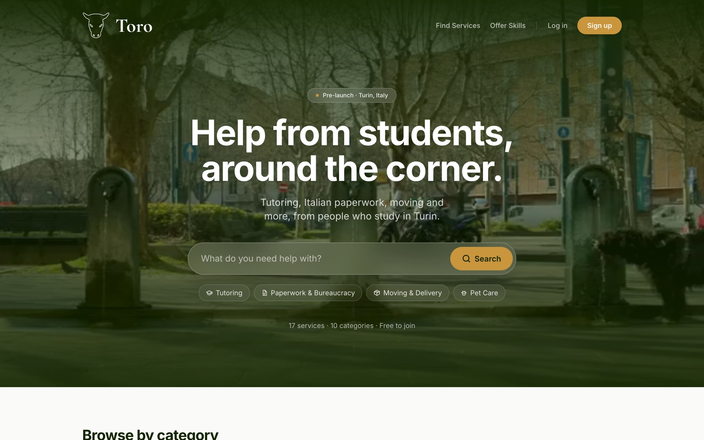
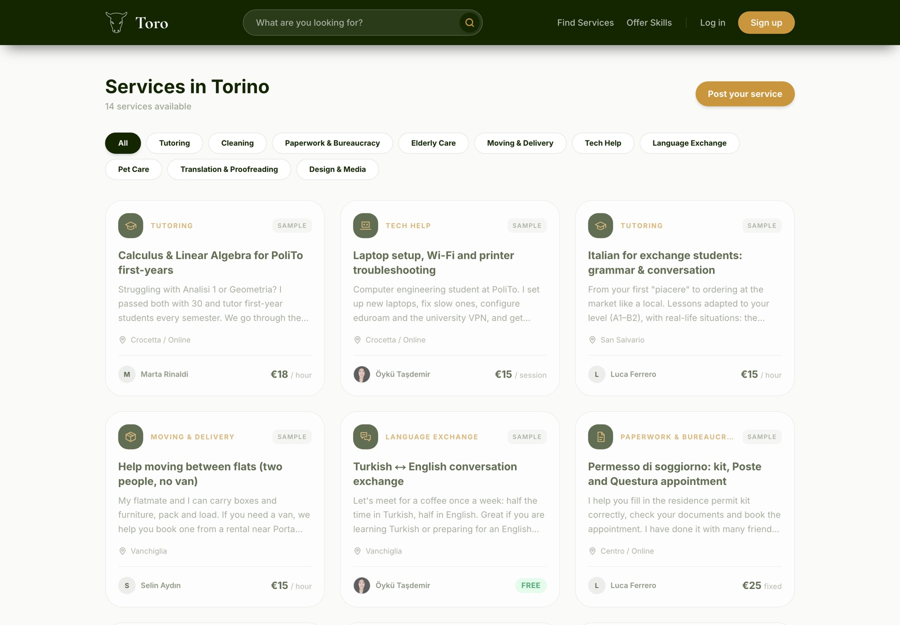
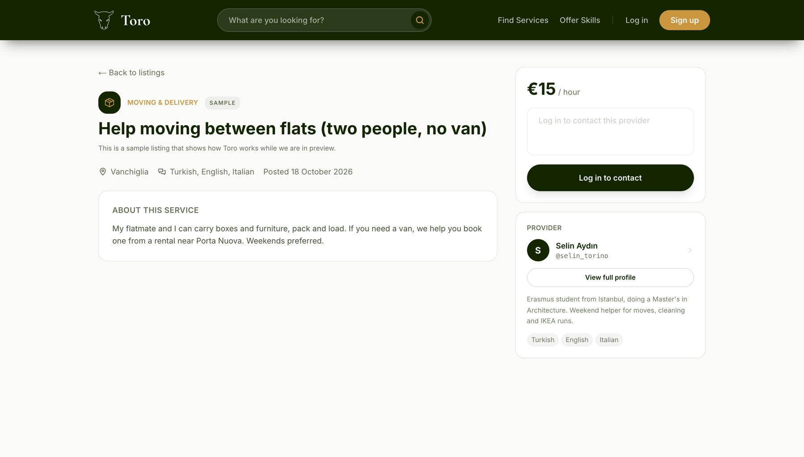
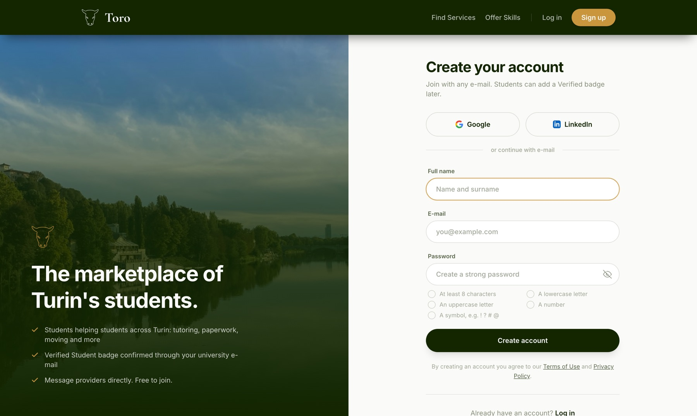

# Toro

**A services marketplace for students in Turin, Italy.**

[](https://github.com/tasdemiroyku/toro/actions/workflows/ci.yml)
&nbsp;**Live demo:** [toro-next.vercel.app](https://toro-next.vercel.app)

Students offer and find everyday help from each other: tutoring, paperwork with
Italian bureaucracy, moving, tech help, pet care, translation and more. The name
comes from the *Toret*, Turin's green bull-head drinking fountains.



> **Pre-launch.** The marketplace works end to end. Listings labelled "Sample" are
> demo content. What comes next is in the [roadmap](ROADMAP.md).

## Highlights

- **Security audited at the database level.** An audit of the live Supabase project
  found gaps the UI was hiding (receivers could rewrite messages, phone numbers were
  readable with the public key). Versioned migrations closed them with Row Level
  Security, column grants and CHECK constraints. Queries: [`supabase/audit/`](supabase/audit).
- **Private data kept apart.** Phone numbers and verified university e-mails live in
  an owner-only table; profiles stay public.
- **Student verification the client cannot fake.** A 6-digit code goes to an
  allow-listed university address. It is stored as an HMAC, expires after 15 minutes,
  allows 5 attempts and is rate-limited.
- **Fast first load.** Home page media on mobile went from 4.9 MB to 35 KB.
- **Quality gates.** Every pull request runs lint (zero warnings), unit tests, a build
  without server secrets and Playwright end-to-end tests; CodeQL scans the code and
  `main` only accepts changes that pass. See [SECURITY.md](SECURITY.md) to report an issue.

## Features

- Sign-up with e-mail, Google or LinkedIn, and a unique username
- Listings in ten categories, with an optional photo compressed in the browser
- Search with category filters, server-side pagination and shareable URLs
- Public profiles at `/u/[username]` and a realtime inbox with read receipts
- Verified Student badge and full account deletion
- Reports and moderation: signed-in users can report a listing or user; admins review them at `/admin/reports`
- Privacy Policy, Terms of Use and a contact form

| Browse | Listing | Sign up |
|---|---|---|
|  |  |  |

## Tech stack

Next.js 16 (App Router, Server Components, Server Actions) · React 19 · Tailwind CSS v4 ·
Framer Motion · Supabase (PostgreSQL with RLS, Auth, Storage, Realtime; EU) · Resend ·
Vercel · GitHub Actions · Playwright

Architecture, engineering decisions and the project layout:
[docs/ARCHITECTURE.md](docs/ARCHITECTURE.md).

## Getting started

Requirements: Node.js 20.9+ and a Supabase project.

```bash
git clone https://github.com/tasdemiroyku/toro.git
cd toro
npm install
cp .env.example .env.local   # fill in your Supabase and Resend keys
npm run dev                  # http://localhost:3000
```

In the Supabase SQL Editor, run the files in `supabase/migrations/` in filename order
(and `supabase/seed/` for demo listings). Enable the Google and LinkedIn (OIDC)
providers with `http://localhost:3000/auth/callback` as a redirect URL.

## Authors and license

Built in Turin by Öykü ([@tasdemiroyku](https://github.com/tasdemiroyku), Computer
Engineering, Politecnico di Torino) and Ogi (Business, Università di Torino).

© 2026 Öykü and Ogi. All rights reserved. The code is public so that it can be
reviewed; reusing it requires written permission.
