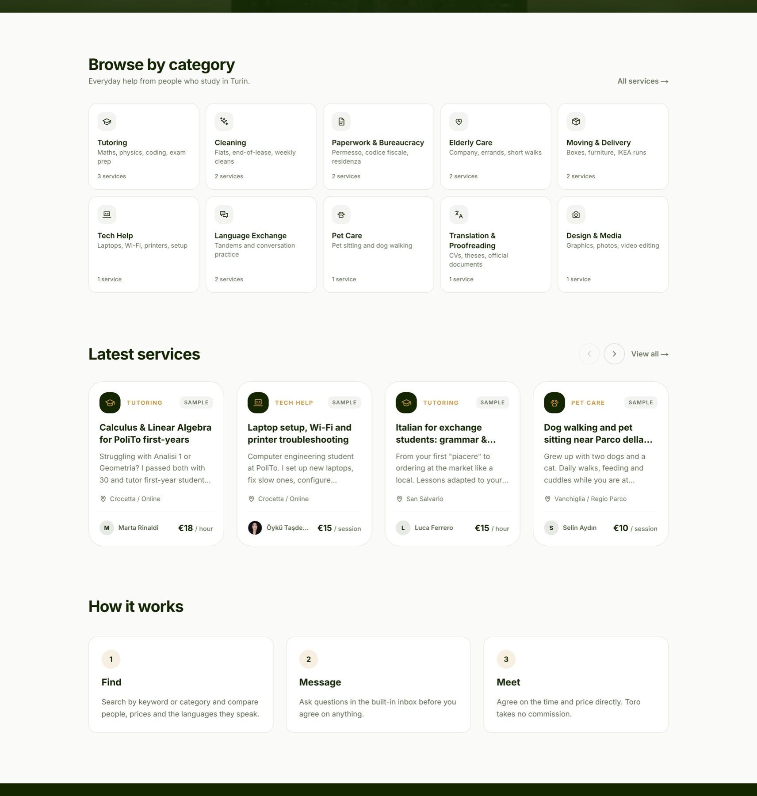
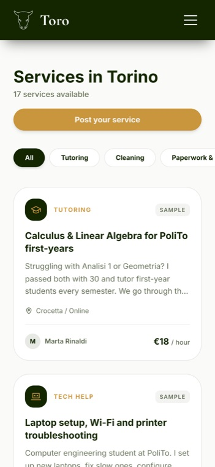
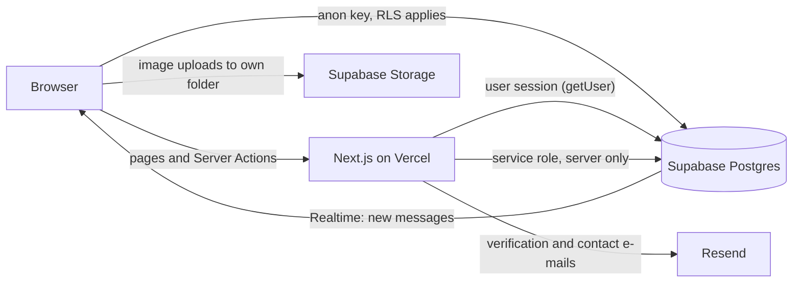

# Toro

**A services marketplace for students in Turin, Italy.**

[](https://github.com/tasdemiroyku/toro/actions/workflows/ci.yml)
&nbsp;**Live demo:** [toro-next.vercel.app](https://toro-next.vercel.app)

Students offer and find everyday help from each other: tutoring, paperwork with
Italian bureaucracy, moving, cleaning, tech help, pet care, translation, design and
language exchange. The name comes from the *Toret*, Turin's green bull-head
drinking fountains.


> **Status: pre-launch.** The marketplace works end to end. Listings labelled
> "Sample" are demo content; moderation and translations are next on the
> [roadmap](ROADMAP.md).

## Highlights

- **Security audited at the database level.** A catalog audit of the live Supabase
  project found gaps the UI was hiding: message receivers could rewrite messages,
  and phone numbers were readable with the public API key. A series of versioned
  migrations fixed them with Row Level Security, column-level grants and CHECK
  constraints. The audit queries are in the repo
  ([`supabase/audit/`](supabase/audit)).
- **Private data is kept apart from public data.** Profiles are public by design,
  so phone numbers and verified university e-mails live in an owner-only table.
- **Student verification without trusting the client.** A 6-digit code is sent to
  an allow-listed university address. Codes are stored as HMACs, expire after 15
  minutes, allow 5 attempts and are rate-limited, and only the server can grant
  the badge.
- **Fast first load.** On mobile the home page dropped from 4.9 MB to 35 KB of media.
  The hero video was re-encoded from 3.5 MB to 0.8 MB and loads only on desktop,
  when motion is allowed and Data Saver is off.
- **Quality gates.** GitHub Actions runs lint, unit tests and a production build on
  every pull request. One test checks that category values in the code match the
  database CHECK constraint.

## Screenshots



| Browse | Listing | Sign up |
|---|---|---|
|  |  |  |

<p align="center">
  
  &nbsp;&nbsp;
  
</p>

## Features

- **Accounts:** e-mail/password, Google and LinkedIn sign-in, password reset, a
  live password checklist, and onboarding with a unique username
- **Listings:** create, edit, pause and delete across ten categories, with an
  optional photo (compressed to WebP in the browser)
- **Search:** keyword and category filters, with server-side pagination and
  shareable URLs
- **Public profiles** at `/u/[username]`, with bio, languages, skills and active listings
- **Messaging:** a realtime inbox per listing, with read receipts and an unread
  indicator
- **Verified Student badge** through a code sent to a university e-mail
- **Account deletion** removes the profile, listings, messages, private data and
  uploaded photos
- **Privacy Policy, Terms of Use** and a contact form that e-mails the team
  without publishing an address

## Tech stack

| Layer | Choice |
|---|---|
| Framework | Next.js 16 (App Router, Server Components, Server Actions) |
| UI | React 19 with React Compiler, Tailwind CSS v4, Framer Motion, Inter |
| Backend | Supabase: PostgreSQL with RLS, Auth, Storage, Realtime (EU, Ireland) |
| E-mail | Resend |
| Hosting & CI | Vercel, GitHub Actions |

## Architecture



- **Server Components fetch, Client Components interact.** Each
  `app/<route>/page.jsx` checks auth and loads data; `components/<Name>Client.jsx`
  handles UI state, animation and realtime.
- **Authorization lives in PostgreSQL.** The browser only has the anon key, so every
  table has Row Level Security. Sensitive columns are protected with column grants,
  not just hidden in queries.
- **Mutations that need trust run as Server Actions:** profile saves, student
  verification, the contact form and account deletion. They validate input on the
  server and return errors to the UI instead of throwing.
- **Defense in depth:** route guards in `proxy.js` (the Next.js 16 middleware),
  `getUser()` again in each protected page, UUID and username validation before
  queries, and `safeRedirectPath()` against open redirects.

## Engineering decisions

| Decision | Why |
|---|---|
| Schema changes as SQL files, applied with *expand → deploy → contract* | Moving phone numbers to a private table never broke the live site |
| Text-first listing cards instead of cover photos | Trust comes from the provider, and repeated stock photos made grids look templated |
| Native horizontal scroll with `scroll-snap` for carousels | Works with touchpads, touch and keyboard, with no paging state to keep in sync |
| A position-fixed home header that switches size with hysteresis | The old scroll-linked resize changed the layout and bounced |
| One page container (`.toro-container`) | Header, sections and footer stay aligned when the window resizes |

More decisions, with dates, are recorded in [ROADMAP.md](ROADMAP.md).

## Getting started

Requirements: Node.js 20.9+ and a Supabase project.

```bash
git clone https://github.com/tasdemiroyku/toro.git
cd toro
npm install
cp .env.example .env.local   # fill in your Supabase and Resend keys
npm run dev                  # http://localhost:3000
```

In Supabase:

- Run the files in `supabase/migrations/` in the SQL Editor, in filename order.
  They create the tables, policies and storage bucket.
- Optionally run `supabase/seed/*.sql` for demo listings.
- Enable the Google and LinkedIn (OIDC) providers, and add
  `http://localhost:3000/auth/callback` to the redirect URLs.

| Script | Purpose |
|---|---|
| `npm run dev` | Development server (Turbopack) |
| `npm run build` | Production build |
| `npm run lint` | ESLint (Next.js Core Web Vitals rules) |
| `npm test` | Unit tests (`node:test`, no extra dependencies) |

## Project structure

```
app/                 Routes (Server Components), Server Actions in app/actions/
components/          Client components (<Name>Client.jsx) and shared UI
lib/                 Pure helpers: categories, password policy, redirects, site constants
utils/               Supabase clients, e-mail, image upload
proxy.js             Middleware: session refresh and route guards
supabase/migrations/ Versioned schema, RLS policies, triggers and storage
supabase/audit/      Read-only SQL to verify policies and schema
supabase/seed/       Demo data
tests/               Unit tests
```

## Authors

Built in Turin by Öykü ([@tasdemiroyku](https://github.com/tasdemiroyku), Computer
Engineering, Politecnico di Torino) and Ogi (Business, Università di Torino).

## License

© 2026 Öykü and Ogi. All rights reserved. The code is public so that it can be
reviewed; reusing it requires written permission.
