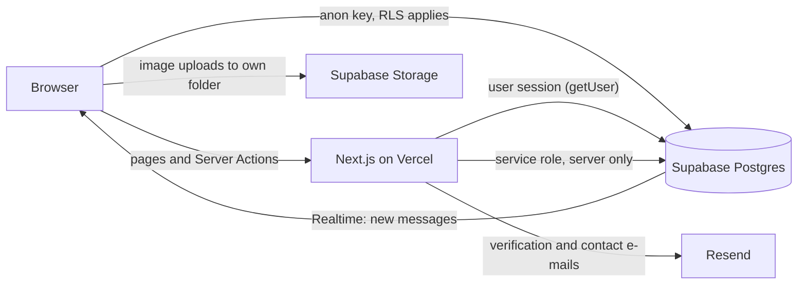

# Architecture

How Toro is built and why. For setup, see the [README](../README.md); for dated
decisions and what comes next, see the [roadmap](../ROADMAP.md).

## Overview



- **Server Components fetch, Client Components interact.** Each
  `app/<route>/page.jsx` checks auth and loads data; `components/<Name>Client.jsx`
  handles UI state, animation and realtime.
- **Authorization lives in PostgreSQL.** The browser only has the anon key, so every
  table has Row Level Security. Sensitive columns are protected with column grants,
  not just hidden in queries.
- **Mutations that need trust run as Server Actions:** profile saves, student
  verification, the contact form and account deletion. They validate input on the
  server and return errors to the UI instead of throwing.
- **Defense in depth:** route guards in `proxy.js` (the Next.js 16 middleware),
  `getUser()` again in each protected page, UUID and username validation before
  queries, and `safeRedirectPath()` against open redirects.

## Engineering decisions

| Decision | Why |
|---|---|
| Schema changes as SQL files, applied with *expand → deploy → contract* | Moving phone numbers to a private table never broke the live site |
| Text-first listing cards instead of cover photos | Trust comes from the provider, and repeated stock photos made grids look templated |
| Native horizontal scroll with `scroll-snap` for carousels | Works with touchpads, touch and keyboard, with no paging state to keep in sync |
| A position-fixed home header that switches size with hysteresis | The old scroll-linked resize changed the layout and bounced |
| One page container (`.toro-container`) | Header, sections and footer stay aligned when the window resizes |

## Project structure

```
app/                 Routes (Server Components), Server Actions in app/actions/
components/          Client components (<Name>Client.jsx) and shared UI
lib/                 Pure helpers: categories, password policy, redirects, site constants
utils/               Supabase clients, e-mail, image upload
proxy.js             Middleware: session refresh and route guards
supabase/migrations/ Versioned schema, RLS policies, triggers and storage
supabase/audit/      Read-only SQL to verify policies and schema
supabase/seed/       Demo data
tests/               Unit tests
```

## Scripts

| Script | Purpose |
|---|---|
| `npm run dev` | Development server (Turbopack) |
| `npm run build` | Production build |
| `npm run lint` | ESLint (Next.js Core Web Vitals rules) |
| `npm test` | Unit tests (`node:test`, no extra dependencies) |
| `npm run test:e2e` | Playwright end-to-end tests against a production build (run `npm run build` first) |

CI (GitHub Actions) runs lint, unit tests and a build without server secrets on every
pull request, then the Playwright tests on desktop and mobile viewports. CodeQL scans
every pull request, and `main` only accepts changes through pull requests that pass CI.
